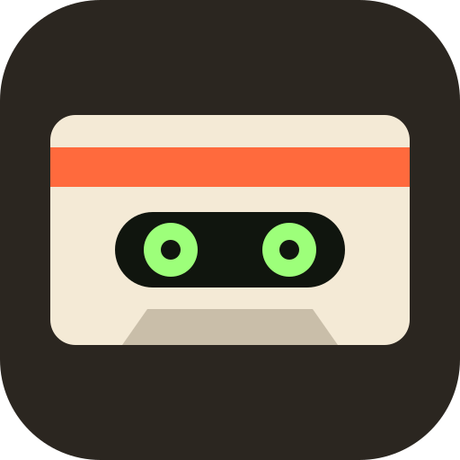
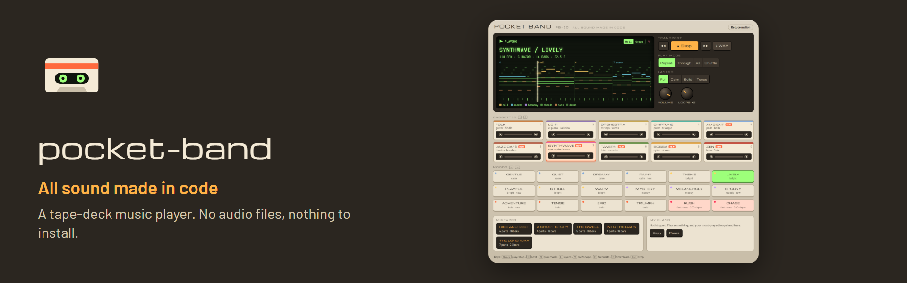

<h1 align="center">pocket-band</h1>

<b>All sound made in code.</b> A tape-deck music player with no audio files.

A music player whose every tune is composed in code, in the browser, with the Web Audio API.

## What this is

A music player that looks like a tape deck. Every note is composed and synthesised in the
browser by the Web Audio API: no audio files, no samples, nothing to install. Plucked strings,
pianos, mallets, winds, synths and drums are all made in code, then mixed with a generated
reverb. Use it as background music, or to pick loops for a game.

## Play it

**Play it online:** <https://ank-khoaho.github.io/pocket-band/> — or download
`pocket-band.html` from the [latest release](https://github.com/Ank-KhoaHo/pocket-band/releases/latest)
and open it: it is the whole player in one file.

To run it from a clone, open [`src/index.html`](src/index.html) in a browser, pick a cassette and a mood, and press
**Play**. The only thing it fetches is its fonts.

- **10 cassettes (styles):** folk, lo-fi, orchestra, chiptune, ambient, jazz café, synthwave,
  tavern, bossa and zen.
- **18 moods** in 5 groups: Calm, Bright, Moody, Bold and Fast. Each is the same 16-bar tune in
  its own key, mode, tempo and band. **Rush** and **Chase** run above 200 BPM.
- **Play modes:** Repeat, Through (every mood of a cassette), All (every mood, then the next
  cassette), Shuffle — changing after 1, 2 or 4 loops, on the loop's end.
- **Layers:** Full, or the loop split into parts — Calm, Build, Tense — that change on the beat.
- **⤓ WAV:** download the loop you hear as a seamless 16-bit stereo WAV, ready for a game.
- **Mixtapes:** 5 sets of moods played back to back, each change on a bar line.
- **♥ and My plays:** mark favourites; your most-played loops are counted in your browser only.

| Key | Does |
|---|---|
| `1`-`0` | pick a cassette |
| `←` `→` | previous or next mood |
| `Space` | play or stop |
| `N` | next |
| `M` | play mode |
| `L` | layers |
| `V` | roll or scope |
| `F` | favourite |
| `D` | download the WAV |
| `Esc` | stop |

Each loop takes a few seconds to build the first time it plays. Every loop is matched to the
same loudness (−24 LUFS), so switching never jumps in volume.

## Where things live

| File | What it holds |
|---|---|
| [PUBLIC.md](PUBLIC.md) | why some material is deliberately not published here |
| [CONTRIBUTING.md](CONTRIBUTING.md) | how to build and test it, and what gets rejected |
| [SECURITY.md](SECURITY.md) | how to report a vulnerability, and what is not one |
| [ROADMAP.md](ROADMAP.md) | direction, and the things deliberately not coming |
| [LICENSE](LICENSE) | what you may do with this |

## Status

Version 1.0.0 is released, and the online player is built from `main` on every push. Every
test renders all 180 loops in headless Chromium and checks that none is silent, broken or too
loud. It is tested in Chromium-based browsers only.

The music and the code are licensed under
[CC BY 4.0](https://creativecommons.org/licenses/by/4.0/): use, change and share them, even
commercially, as long as you credit **"pocket-band" by Khoa Ho**. See [LICENSE](LICENSE).

## Limits

- **It plays one tune.** Every mood re-arranges the same 16-bar theme. It does not write new melodies.
- **A loop builds before it plays.** The first play of a loop waits 1 to 4 seconds.
- **It needs a click first.** Browsers start no sound before a click or a key.
- **It exports WAV only.** One loop at a time; there is no MIDI or MP3.
- **Favourites live in one browser.** Clearing the site's data loses them.
- **Firefox and Safari are untested.** The tests run in Chromium only.

## Alternatives

- **Recorded music** sounds like real players. A royalty-free music library is the better choice for that.
- **Your own composition** needs a DAW or a tracker. pocket-band has no editor.
- **Music made by your own code** needs a library such as Tone.js. pocket-band is a player, not a library.

## FAQ

**Can I use the loops in my game?** Yes, even in a paid game. Credit "pocket-band" by Khoa Ho,
as CC BY 4.0 asks.

**Does it send anything anywhere?** No. It fetches its fonts from Google Fonts, and nothing
else. Your favourites and play counts stay in your browser.

**Does it work offline?** Yes, as the downloaded file. Without a network the fonts fall back to
your system's own.

**Why are there no audio files?** Every sound is made by code as it plays. The whole player is
one file of about 133 KB.
